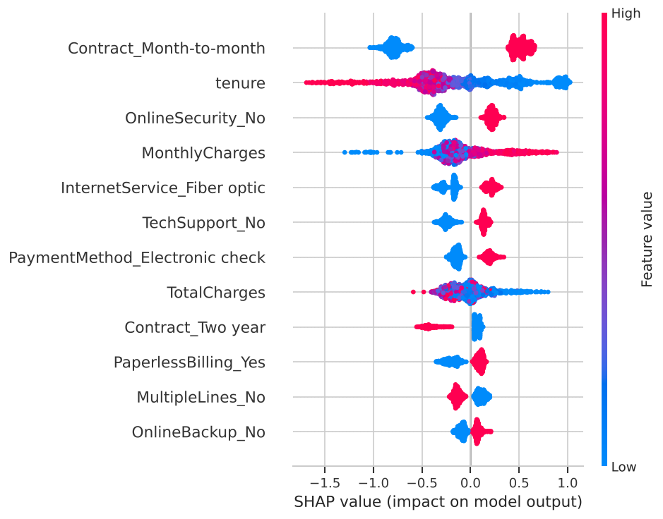
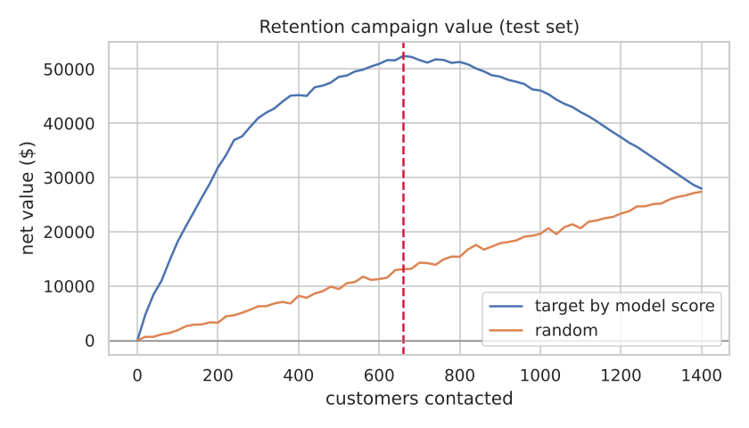

# Telecom Customer Churn: Prediction and Retention Targeting

Predicts which telecom customers will cancel, explains each prediction with SHAP, and estimates the value of a retention campaign aimed at the highest-risk customers.



## Data

[IBM Telco Customer Churn](https://github.com/IBM/telco-customer-churn-on-icp4d): 7,043 customers with demographics, services, contract, billing and a churn flag (26.5% churned). The notebook loads it straight from GitHub.

## Approach

- Stratified 80/20 split with 5-fold cross-validation on the training set
- One-hot encoding and scaling in a scikit-learn `Pipeline`, so preprocessing is fit on training data only
- Logistic regression and XGBoost compared on ROC-AUC and PR-AUC
- SHAP for global feature effects and for single-customer explanations
- A profit curve for a retention offer, comparing model-ranked targeting with random contact

## Results

| Model | CV ROC-AUC | Test ROC-AUC | Test PR-AUC |
|---|---:|---:|---:|
| Logistic regression | 0.846 | 0.842 | 0.635 |
| XGBoost | 0.847 | 0.845 | 0.664 |

**Why customers leave**

- Contract type matters most: month-to-month customers churn at 42.7%, two-year customers at 2.8%.
- Short tenure, high monthly charges and fiber internet raise churn risk.
- Customers without online security or tech support, and those paying by electronic check, churn more. Those are specific levers for offers (bundled support, auto-pay discounts).

**Campaign value** (assumes a $50 offer, a 30% save rate and 12 months of retained revenue)

Contacting the 660 highest-risk test customers returns about **$52,000 net**, four times the return from contacting the same number at random (about $13,000).



## How to run

```bash
git clone https://github.com/mehtesham13/customer-churn-prediction.git
cd customer-churn-prediction
pip install -r requirements.txt
jupyter notebook churn_prediction.ipynb
```

Author: Muhammad Ehtesham · [LinkedIn](https://www.linkedin.com/in/muhammad-ehtesham-dsa)
